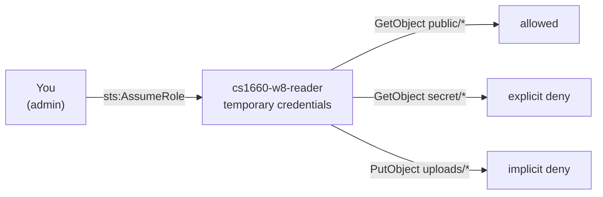
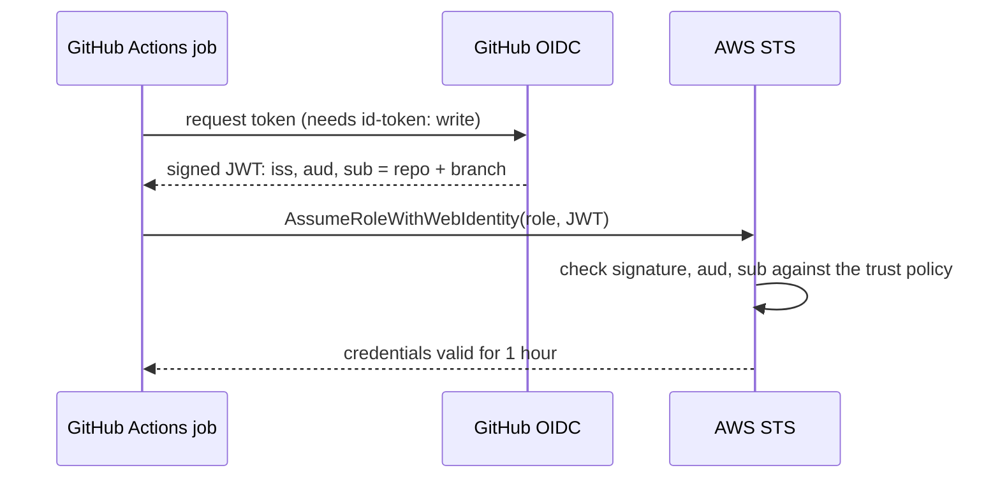

# Week 8: IAM

Two demos. The first makes AWS say "no" in each of the ways it can, on purpose. The second replaces the access keys you would otherwise paste into GitHub with a role that only one repo and branch can assume.

## 01-policy-evaluation

A bucket with two files, and a role (`cs1660-w8-reader`) that may read everything except `secret/*`. `reader.sh` assumes the role first, so every call really runs as it and every error is the real AccessDenied message.



```bash
cd week-08/iam-policy-evaluation
terraform init && terraform apply
terraform output try_it
```

| Step | Command | Expect |
|---|---|---|
| Who am I? | `./reader.sh whoami` | your ARN, then `assumed-role/cs1660-w8-reader/cs1660-demo` |
| Allow | `./reader.sh get public/hello.txt` | the file's contents |
| Explicit deny | `./reader.sh get secret/grades.csv` | `AccessDenied ... with an explicit deny in an identity-based policy` |
| Implicit deny | `./reader.sh put uploads/hw.txt` | `AccessDenied ... because no identity-based policy allows the s3:PutObject action` |
| Ask, don't try | `./reader.sh simulate` | the same three answers from the policy simulator, without making the calls |
| Fix it | `terraform apply -var allow_uploads=true`, then `put` again | allowed; `put secret/x.txt` still fails |

Things to point at in `main.tf`: `s3:ListBucket` uses the bucket ARN while `s3:GetObject` uses `bucket/*`, and the trust policy's `arn:aws:iam::<account>:root` means "this account", not the root user.

## 02-github-oidc

A role that a GitHub Actions job can assume with a short-lived OIDC token, so no AWS access key is ever stored in GitHub.



```bash
cd week-08/github-oidc
./repo-ids.sh <owner>/<repo>         # prints the four values below
terraform init
terraform apply \
  -var github_owner=<owner> -var github_owner_id=<id> \
  -var github_repo=<repo>   -var github_repo_id=<id>
```

Then, in that repo:

1. Copy `workflow/whoami.yml` to `.github/workflows/whoami.yml` and push to `main`.
2. Add a repository **variable** (not a secret) named `AWS_ROLE_ARN` with the `role_arn` output.
3. Run the workflow from the Actions tab. `get-caller-identity` shows `assumed-role/cs1660-w8-github/...`, `s3 ls` works, `ec2 describe-instances` is denied.

**The subject claim changed this year.** Repositories created after July 15, 2026 (which includes every GitHub Classroom repo this term) put numeric owner and repo IDs in the `sub` claim: `repo:owner@123/repo@456:ref:refs/heads/main`. A trust policy written in the old `repo:owner/repo:...` form will reject them. For an older repo that has not opted in, apply with `-var use_immutable_subject=false`.

Already have a GitHub OIDC provider in your account (from a tutorial or another project)? Add `-var create_oidc_provider=false`; there can only be one per account.

For assignment 2, replace the `list-buckets-only` policy with ECR push permissions scoped to your repository, and add `docker push` steps to the workflow.

## Clean up

```bash
(cd 02-github-oidc && terraform destroy -var github_owner=x -var github_repo=x)
(cd 01-policy-evaluation && terraform destroy)
```
