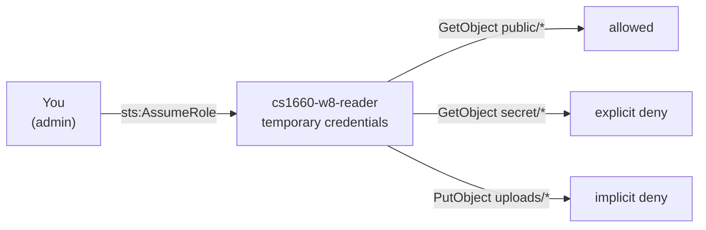
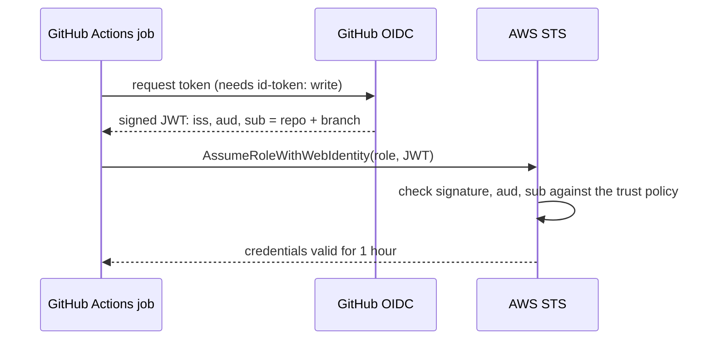

# Week 8: IAM

Two demos. The first makes AWS say "no" in each of the ways it can, on purpose. The second replaces the access keys you would otherwise paste into GitHub with a role that only one repo and branch can assume.

## 01 — IAM policy evaluation

A bucket with two files, and a role (`cs1660-w8-reader`) that may read everything except `secret/*`. `reader.sh` assumes the role first, so every call really runs as it and every error is the real AccessDenied message.



```bash
cd week-08/iam-policy-evaluation
terraform init && terraform apply
terraform output try_it
```

| Step | Command | Expect |
|---|---|---|
| Who am I? | `./reader.sh whoami` | your ARN, then `assumed-role/cs1660-w8-reader/cs1660-demo` |
| Allow | `./reader.sh get public/hello.txt` | the file's contents |
| Explicit deny | `./reader.sh get secret/grades.csv` | `AccessDenied ... with an explicit deny in an identity-based policy` |
| Implicit deny | `./reader.sh put uploads/hw.txt` | `AccessDenied ... because no identity-based policy allows the s3:PutObject action` |
| Ask, don't try | `./reader.sh simulate` | the same three answers from the policy simulator, without making the calls |
| Fix it | `terraform apply -var allow_uploads=true`, then `put` again | allowed; `put secret/x.txt` still fails |

Things to point at in `main.tf`: `s3:ListBucket` uses the bucket ARN while `s3:GetObject` uses `bucket/*`, and the trust policy's `arn:aws:iam::<account>:root` means "this account", not the root user.

## 02 — GitHub OIDC

A role that a GitHub Actions job can assume with a short-lived OIDC token, so no AWS access key is ever stored in GitHub. See [`github-oidc/README.md`](github-oidc/README.md) for the full walkthrough.



### Quick steps

1. Create the OIDC identity provider in IAM (one per account)
2. Create an IAM role with a trust policy scoped to your repo
3. Copy `workflow/whoami.yml` to `.github/workflows/` and push
4. Add a repository **variable** `AWS_ROLE_ARN` with the role ARN
5. Run the workflow from the Actions tab — `get-caller-identity` shows the assumed role, `s3 ls` works, `ec2 describe-instances` is denied

**The subject claim changed this year.** Repos created after July 15, 2026 (including GitHub Classroom repos this term) put numeric owner and repo IDs in the `sub` claim. The `pitt-itcc` org ID is **328444000**. Get your repo ID with:

```bash
curl -s https://api.github.com/repos/pitt-itcc/<YOUR_REPO> | jq '.id'
```

## Clean up

```bash
cd week-08/iam-policy-evaluation
terraform destroy
```
