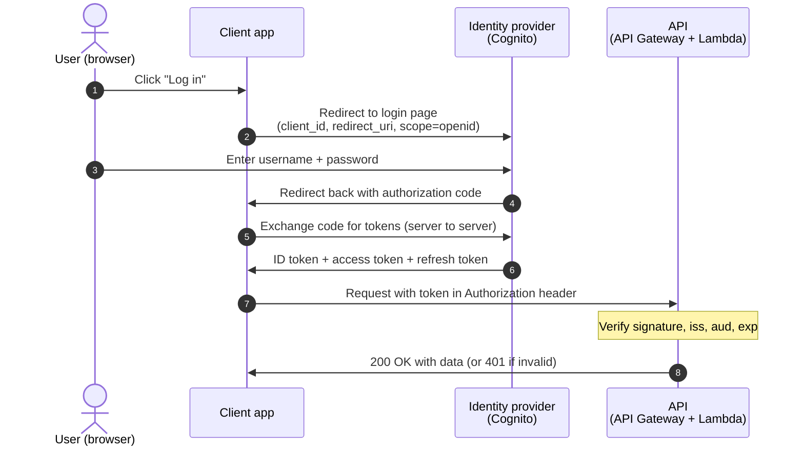

# OIDC Login Flow (Authorization Code Flow)

This is the flow we drew on the whiteboard in week 9: how a user logs in to an app through an identity provider like Amazon Cognito, and how the app then calls an API on their behalf.

**The players**

- **User:** the person logging in, using a browser
- **Client app:** your frontend (for example, a site on S3 + CloudFront)
- **Identity provider:** issues tokens after the user logs in (Amazon Cognito, Google, GitHub)
- **API:** your backend (API Gateway + Lambda), which only accepts requests with a valid token

## What happens, step by step

The numbers match the arrows in the diagram below.

1. The user clicks **Log in** in the client app.
2. The client app redirects the browser to the identity provider's login page. The redirect says which app is asking (`client_id`), where to send the user back (`redirect_uri`), and what it wants (`scope=openid email`). Asking for the `openid` scope is what makes this an OIDC login.
3. The user enters their username and password **on the identity provider's page**, never in the client app.
4. The identity provider redirects the browser back to the client app with a short-lived, single-use **authorization code**. The code is useless on its own, so it is safe to pass through the browser.
5. The client app sends the code directly to the identity provider (server to server, not through the browser) and asks to trade it for tokens.
6. The identity provider returns three tokens:
    - **ID token:** a signed JWT that says who the user is (`sub`, `email`). This is what OIDC adds on top of OAuth2.
    - **Access token:** proves what the app is allowed to do. This is what you send to an API.
    - **Refresh token:** used to get new tokens when the others expire, without logging in again.
7. The client app calls the API with the token in the `Authorization` header.
8. The API checks the token: is the signature valid, did it come from the expected issuer (`iss`), is it meant for this app (`aud`), and has it expired (`exp`)? If the token is valid, the API returns the data. If not, it returns `401 Unauthorized` and your code never runs. With API Gateway's Cognito authorizer, API Gateway does this check for you.

## Diagram

## Reference docs

- [RFC 6749: The OAuth 2.0 Authorization Framework](https://datatracker.ietf.org/doc/html/rfc6749), section 4.1 is the authorization code flow
- [RFC 7636: PKCE](https://datatracker.ietf.org/doc/html/rfc7636)
- [OAuth 2.0 Security Best Current Practice (RFC 9700)](https://datatracker.ietf.org/doc/html/rfc9700)
- [OpenID Connect Core 1.0](https://openid.net/specs/openid-connect-core-1_0.html)
- [Amazon Cognito user pool endpoints](https://docs.aws.amazon.com/cognito/latest/developerguide/cognito-userpools-server-contract-reference.html)
- [Verifying a Cognito JSON Web Token](https://docs.aws.amazon.com/cognito/latest/developerguide/amazon-cognito-user-pools-using-tokens-verifying-a-jwt.html)
- [GitHub: About security hardening with OpenID Connect](https://docs.github.com/en/actions/security-for-github-actions/security-hardening-your-deployments/about-security-hardening-with-openid-connect)