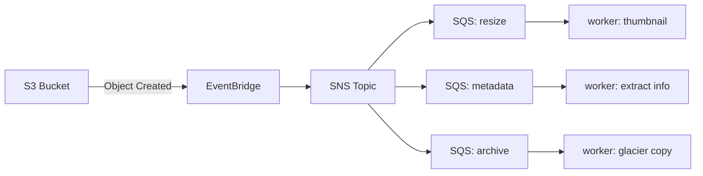

# EventBridge Fan-Out Demo

S3 image upload triggers an EventBridge rule that publishes to SNS, which fans out to three SQS queues. Each queue drives a local Python worker that does different "work" on the same image.



## Deploy

```bash
cd week-11/eventbridge-fanout
terraform init
terraform apply
```

Grab the outputs — you'll need the bucket name and queue URLs:

```bash
terraform output
```

## Set up the workers

```bash
cd worker
uv sync
cd ..
```

## Run the workers

Open three terminals from the `eventbridge-fanout/` directory and start one worker in each:

```bash
# terminal 1 — resize worker
uv run --project worker python worker/worker.py --queue-url $(terraform output -raw resize_queue_url) --task resize

# terminal 2 — metadata worker
uv run --project worker python worker/worker.py --queue-url $(terraform output -raw metadata_queue_url) --task metadata

# terminal 3 — archive worker
uv run --project worker python worker/worker.py --queue-url $(terraform output -raw archive_queue_url) --task archive
```

Each worker long-polls its queue (20s intervals) and processes messages as they arrive.

## Upload an image

```bash
BUCKET=$(terraform output -raw bucket_name)
aws s3 cp cathy-rainbow.jpg s3://$BUCKET/uploads/cathy-rainbow.jpg
aws s3 cp cathy-commons-room.jpg s3://$BUCKET/uploads/cathy-commons-room.jpg
aws s3 cp cathy-heinz-chapel.jpg s3://$BUCKET/uploads/cathy-heinz-chapel.jpg
```

Images **must** go under the `uploads/` prefix — the EventBridge rule only matches that prefix so worker output (`resized/`, `archive/`) doesn't re-trigger the pipeline.

Watch the three terminals — each worker picks up the same event and does its own thing:

- **resize** — creates a 200×200 thumbnail at `resized/<filename>`
- **metadata** — prints format, dimensions, mode, content-type, size
- **archive** — copies to `archive/<filename>` with `GLACIER_IR` storage class

## Verify

```bash
aws s3 ls s3://$(terraform output -raw bucket_name) --recursive
```

You should see the original under `uploads/`, the thumbnail under `resized/`, and the glacier copy under `archive/`.

## Cleanup

```bash
terraform destroy
```
