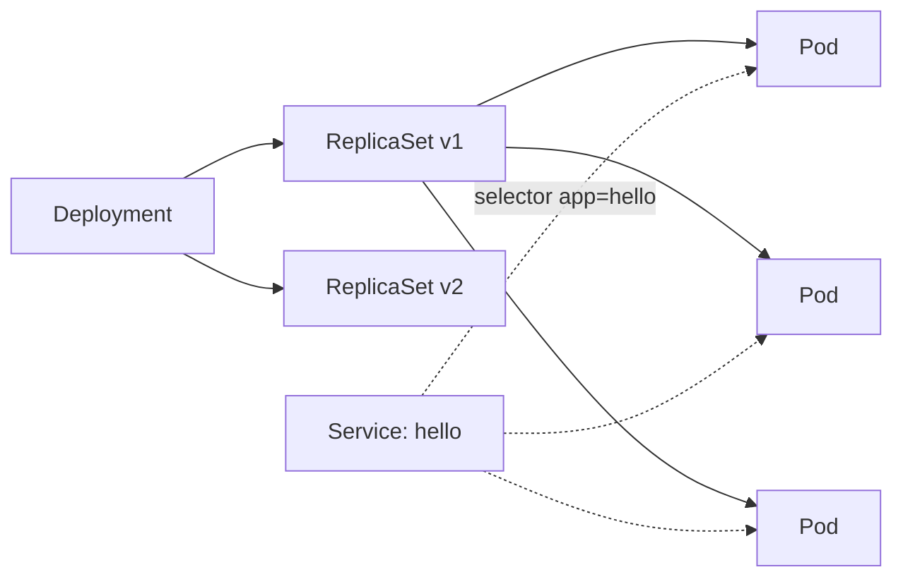

# Kubernetes I: Core Objects — Demo

Self-healing, rolling updates, rollback, and Service DNS on a local KinD cluster.



## Setup

```bash
docker pull traefik/whoami:v1.10 traefik/whoami:v1.11 busybox:1.36

kind create cluster --name itcc --config kind.yaml

kind load docker-image traefik/whoami:v1.10 traefik/whoami:v1.11 busybox:1.36 --name itcc
```

```bash
kubectl get nodes
kubectl get pods -n kube-system
docker ps
```

## Demo 1 — Self-Healing and Rollouts

### 1. Deploy and watch

```bash
# terminal 1
kubectl get pods -w

# terminal 2
kubectl apply -f deploy.yaml
```

### 2. Kill a Pod — watch it come back

```bash
kubectl delete pod <pick one from the watch>
kubectl get pods -o wide
```

### 3. Rolling update to v1.11

Edit `deploy.yaml`, change `image: traefik/whoami:v1.10` to `image: traefik/whoami:v1.11`:


```bash
kubectl apply -f deploy.yaml

# switch the watch to ReplicaSets to see the rollout
kubectl get rs -w
```

```bash
kubectl rollout status deploy/hello
kubectl rollout history deploy/hello
```

### 4. Break it, then undo

```bash
kubectl set image deploy/hello web=traefik/whoami:does-not-exist
kubectl describe pod <the broken one>
kubectl rollout undo deploy/hello
```

## Demo 2 — Services and DNS

### 1. Expose the Deployment

```bash
kubectl apply -f service.yaml
kubectl get svc hello
kubectl get endpointslices -l kubernetes.io/service-name=hello
```

### 2. Resolve and call from inside the cluster

```bash
kubectl run tmp --rm -it --image=busybox:1.36 -- sh
```

```
nslookup hello
wget -qO- http://hello:8080
cat /etc/resolv.conf
```

### 3. Break the label

```bash
kubectl edit svc hello   # change selector to app: helo
kubectl get endpointslices -l kubernetes.io/service-name=hello
```

### 4. Port-forward

```bash
kubectl port-forward svc/hello 8080:8080
```

```bash
curl localhost:8080
```

## Cleanup

```bash
kind delete cluster --name itcc
```
