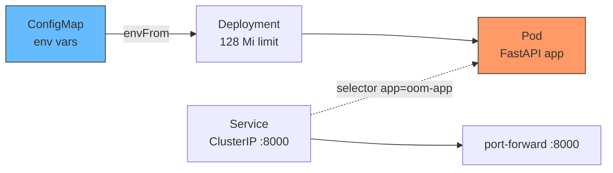

# OOM Kill Demo: ConfigMaps, Resource Limits, and the OOM Killer

A FastAPI app with an `/eat/{mb}` endpoint that allocates memory on demand.
The Deployment sets a 128 Mi memory limit — push past it and the kernel
OOM-kills the container. Kubernetes restarts it and records the reason.



| Path | What it is |
| --- | --- |
| `src/app.py` | FastAPI app: `GET /` shows config, `POST /eat/{mb}` allocates memory |
| `Dockerfile` | Python 3.12-slim + fastapi/uvicorn |
| `k8s/namespace.yaml` | `oom-demo` namespace |
| `k8s/configmap.yaml` | `APP_NAME`, `APP_ENV`, `APP_MESSAGE` injected as env vars via `envFrom` |
| `k8s/deployment.yaml` | Deployment with `resources.limits.memory: 128Mi` |
| `k8s/service.yaml` | ClusterIP on port 8000 |

## Setup

Assumes the `itcc` KinD cluster from `k8s-core-objects/` is running.

```bash
docker build -t oom-demo:latest .
kind load docker-image oom-demo:latest --name itcc
kubectl apply -f k8s/namespace.yaml -f k8s/configmap.yaml -f k8s/deployment.yaml -f k8s/service.yaml
```

## Demo steps

```bash
# configmap → env vars
kubectl port-forward -n oom-demo svc/oom-app 8000:8000 &
curl -s localhost:8000 | jq .

# resource limits
kubectl describe pod -n oom-demo -l app=oom-app | grep -A4 Limits

# watch pods in another terminal
kubectl get pods -n oom-demo -w

# allocate memory in chunks, then blow past the 128 Mi limit
curl -s -X POST localhost:8000/eat/50 | jq .
curl -s localhost:8000 | jq .held_mb
curl -s -X POST localhost:8000/eat/100 | jq .

# inspect the OOMKilled event
kubectl describe pod -n oom-demo -l app=oom-app
```

## Cleanup

```bash
kubectl delete namespace oom-demo
```
