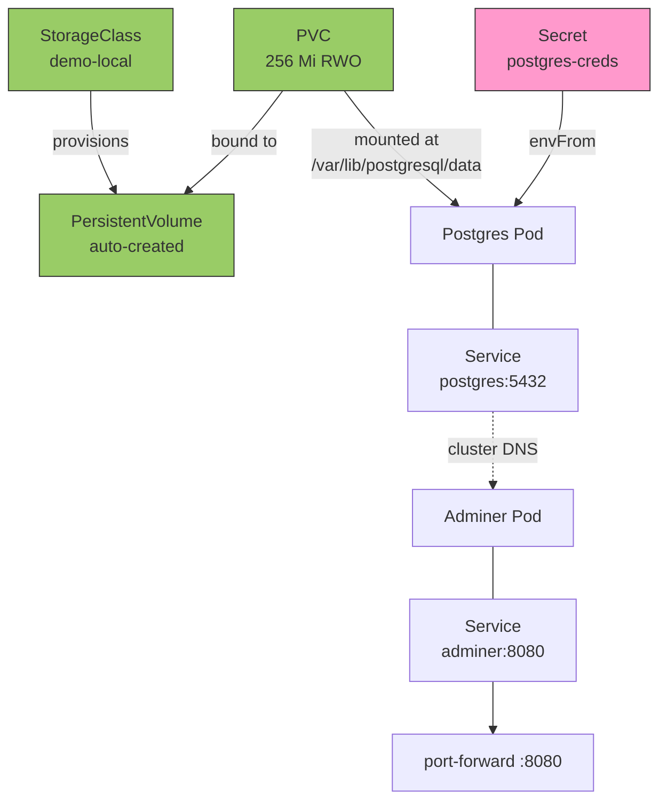

# Persistent Data Demo: StorageClass, PVC, and Surviving a Pod Delete

PostgreSQL with a PersistentVolumeClaim and Adminer as a web UI. Insert a
row, delete the pod, watch it come back with the data still there.



| Path | What it is |
| --- | --- |
| `k8s/namespace.yaml` | `pgdata-demo` namespace |
| `k8s/storageclass.yaml` | `demo-local` SC using KinD's local-path provisioner |
| `k8s/postgres-pvc.yaml` | 256 Mi ReadWriteOnce claim |
| `k8s/postgres-secret.yaml` | `POSTGRES_USER`, `POSTGRES_PASSWORD`, `POSTGRES_DB` |
| `k8s/postgres.yaml` | Deployment + ClusterIP Service mounting the PVC |
| `k8s/adminer.yaml` | Deployment + ClusterIP Service (web UI on port 8080) |

## Setup

Assumes the `itcc` KinD cluster from `k8s-core-objects/` is running.

```bash
docker pull postgres:17-alpine adminer:4
kind load docker-image postgres:17-alpine adminer:4 --name itcc
```

Apply in order — the SC must exist before the PVC, and the Secret before Postgres:

```bash
kubectl apply -f k8s/namespace.yaml
kubectl apply -f k8s/storageclass.yaml
kubectl apply -f k8s/postgres-secret.yaml
kubectl apply -f k8s/postgres-pvc.yaml
kubectl apply -f k8s/postgres.yaml
kubectl apply -f k8s/adminer.yaml
```

Wait for both pods:

```bash
kubectl get pods -n pgdata-demo -w
```

## Demo steps

```bash
# storage chain: SC → PV → PVC
kubectl get sc
kubectl get pvc -n pgdata-demo
kubectl get pv

# adminer UI
kubectl port-forward -n pgdata-demo svc/adminer 8080:8080 &
# open http://localhost:8080 — system: PostgreSQL, server: postgres,
# user: demo, password: changeme, database: demo
# create a table, insert a row

# kill the pod — data survives
kubectl delete pod -n pgdata-demo -l app=postgres
kubectl get pods -n pgdata-demo -w
# refresh adminer — row is still there

# inspect the secret (base64, not encrypted)
kubectl get secret postgres-creds -n pgdata-demo -o yaml
kubectl get secret postgres-creds -n pgdata-demo -o jsonpath='{.data.POSTGRES_PASSWORD}' | base64 -d
```

## Cleanup

```bash
kubectl delete namespace pgdata-demo
kubectl delete sc demo-local
```
